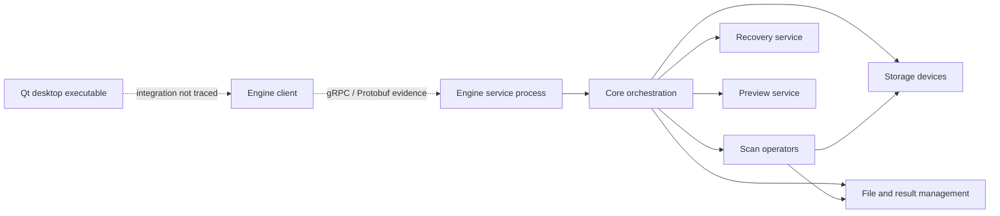

# Recoverit: bounded static architecture review

Date: **25 October 2026**. Initial scope: eight binaries from a user-supplied Windows installation. The later instruction-analysis section adds Windows scan/plugin inspection and the official ARM64 macOS application, examined at the user's explicit request. This review records observations for independent engineering; it does not establish feature parity with Recoverit.

**Summary:** a Quick scan reporting 448 KiB read is not evidence that an entire card was scanned. Metadata traversal can finish after reading a small portion of a device. Recoverit's SD Card Recovery Pro is a distinct workflow; the later static analysis below establishes actual calls for camera identification, scan-task composition, MP4 sample/fragment matching and separate video repair. It does not establish recovery success or recover the complete algorithms. Memory Regainer v0.1.2 has no MP4/MOV/MXF/MTS fragment reconstruction or automatic video repair.

## Method and boundaries

PE/COFF headers, section tables, imports, exports, C++ symbol names and selected filesystem/recovery identifiers in ASCII and UTF-16 strings were inspected. RVA-to-file-offset mapping and bounds checks followed the [Microsoft PE format specification](https://learn.microsoft.com/en-us/windows/win32/debug/pe-format). SHA-256 was computed over each complete file. `file` independently identified the sampled executables as Windows x86-64 PE32+.

None of the supplied executables, DLLs, installers or scripts was run. The initial pass did not analyze instructions; the explicitly requested follow-up below examines bounded function bodies and direct call sites. No complete source-code decompilation, process injection, activation change, DRM bypass or credential inspection was performed. User logs, cookies and account/activation data were not examined. Proprietary binaries, assets, signature databases, protocol schemas, disassembly and reconstructed implementation code were not added to Memory Regainer or published. Temporary local disassembly was used for analysis; only this descriptive report and compact evidence metadata are repository deliverables.

Imports show referenced modules/functions, not the arguments, control flow or runtime use of those functions. An imported write API does not by itself prove source-disk writes: it may write recovered files or other outputs. RTTI/type names are evidence of compiled types, not proof that every named feature works, is enabled or has a particular recovery success rate. Unanchored keyword counts were used only to guide inspection, not as support claims.

## Identified files

All eight use PE32+ machine `0x8664` (AMD64). These hashes identify only the supplied copies; authenticity and vendor signatures were not validated.

| File | Bytes | SHA-256 |
| --- | ---: | --- |
| `recoverit.exe` | 42,032,344 | `612387056df6c220947df9a01b9e7bf08d96689734dd1aeaeba2715d81c4b1d0` |
| `drcore.dll` | 1,738,456 | `5902fe4cc52c7809619b2c2f9cdb28d6d4cdccbabe45143c4a8983a86b492420` |
| `datarecovery.dll` | 1,241,304 | `07f5f1cbf459dcc8c5c64cf1170a2f609f45bae28ba9e3a0ef6e80ee9d1d5377` |
| `drengsrv.exe` | 5,273,304 | `452e12c74558b67bf698a825b220c4176c5fe3101075ac790470b79f11ea568d` |
| `drengcli.dll` | 4,893,400 | `87b2f951337b50bc573b0adbe78c6abd851d5bcda6b8d945dde8a476b55e8d54` |
| `drstoragedevice.dll` | 5,192,920 | `bbf5d75c754cb0e485f2b04534c623e2117667654c47d37eed3a3d962a021756` |
| `PartitionManager.dll` | 3,761,368 | `03ca578ff582bef37a304d8a5240381d25e94a602c4d6c3750d28f559e92db45` |
| `scanopreator.dll` | 5,376,728 | `e4981d562a8d14e2f2ff309bbde5e318c0ad6442be00d42a733c5269cc542a3a` |

## Observations and interpretation

| Area | Directly observed evidence | Bounded interpretation |
| --- | --- | --- |
| Desktop interface | `recoverit.exe` imports Qt5 Widgets, Gui, Core and Concurrent modules. | A Qt desktop shell is present. Its exact hand-off to the engine client was not traced. Memory Regainer can retain its independent Tauri interface. |
| Service boundary | `drengsrv.exe` imports `drcore.dll`. `drengcli.dll` exports `InitGrpcServiceLib`; both client/server contain Protobuf identifiers. Client RTTI includes scan and recovery request/reply types. | Strong evidence of a typed client/service architecture using gRPC/Protobuf. Endpoints, network exposure, transport security and message contracts were not reconstructed. |
| Core orchestration | `drcore.dll` imports separate scan, storage, recovery, preview, file-management and data-management DLLs. Exported identifiers include engine/scan/recovery managers, task queues and buffer creation. | Recovery appears coordinated through shared abstractions and dedicated subsystems rather than one monolithic signature loop. Exact scheduling and ownership are unknown. |
| Windows storage | `drstoragedevice.dll` imports SetupAPI enumeration, COM, volume enumeration, `DeviceIoControl`, file reads and seeking. Its symbols refer to API/WMI disk discovery and lost-partition exploration. | Storage discovery and I/O are abstracted separately. Imported APIs do not prove any particular IOCTL, access mode, privilege or error-handling policy. |
| Filesystem strategies | `scanopreator.dll` exposes scan-operator factories. RTTI names identify NTFS, exFAT, FAT16/32, ext4, APFS, Btrfs, HFS+ and ReFS scan operators, including deletion/format variants. | The binary contains filesystem-specific strategies. It is not sufficient evidence to claim complete support for each filesystem, encrypted state or deletion scenario. |
| Raw and fragmented scanning | RTTI includes a raw scan operator and JPEG, MP4, MXF, PDF and ZIP fragment-related operators. NTFS log scanning types also appear. | Metadata recovery and content scanning are distinct paths, with format-specific fragmentation work. The reconstruction heuristics and correctness were not recovered from names. |
| Work selection | Core identifiers refer to filesystem/advanced-scan bitmaps, buffer windows, queues and bad-sector counters. | Likely mechanisms for choosing work ranges and coordinating I/O. Bitmap semantics, buffer sizes, retry policies and complexity remain unknown. |
| Lifecycle and saved state | Symbols refer to pause/resume/stop at engine, scan, recovery and task levels, plus save/load scan results and persistence. | The API exposes controls beyond a single start/cancel operation. Safe checkpoint semantics, crash consistency and source validation were not established. |
| Recovery service | `datarecovery.dll` contains recovery-interface types and a factory returning a recovery interface. | A distinct recovery service exists. One factory's name refers to preview, so names alone should not be used to infer its entire role. |
| Separate partition utilities | `PartitionManager.dll` exports names for disk layouts, GPT/MBR construction, partition changes and boot/migration services; it imports VSS and volume APIs. | The installation includes functionality beyond undelete. This DLL was not a direct import of the inspected core. Its modifying operations are not appropriate additions to Memory Regainer's read-only recovery flow. |

The following diagram separates observed imports (solid arrows) from inferred integration (dotted arrows):

The service/client interpretation is consistent with the general concepts in the [official gRPC architecture documentation](https://grpc.io/docs/what-is-grpc/core-concepts/). That documentation is not evidence of this product's exact wire protocol or deployment configuration.

## Independent implementation priorities for Memory Regainer

These are engineering proposals derived from common requirements and public standards. No recovered proprietary implementation is needed to implement them.

1. **Filesystem recovery before expanding marketing claims.** The subsequent v0.1.0 implementation added a narrow exFAT path using Microsoft's [exFAT specification](https://learn.microsoft.com/en-us/windows/win32/fileio/exfat-specification). Expand interoperability and malformed-image fixtures while keeping allocated-versus-free evidence, fragmentation assumptions and overwritten ranges explicit; see the [feature matrix](FEATURES.md).
2. **NTFS with real record/run validation.** Implement image-based MFT record checks, update-sequence fixups, resident/nonresident attributes, bounded runlists and deleted-record handling from independently reviewed public sources. A common shortcut is insufficient: Microsoft's [FSCTL_GET_NTFS_FILE_RECORD](https://learn.microsoft.com/en-us/windows/win32/api/winioctl/ni-winioctl-fsctl_get_ntfs_file_record) returns in-use records; that API alone is not an undelete engine. Validate results on synthetic images before claiming NTFS recovery.
3. **Stable storage interfaces and physical-device identity.** Expose geometry, bounded `read_at`, cancellation and explicit read errors behind a platform-neutral reader. Qualify native Windows mapping using documented APIs such as [IOCTL_VOLUME_GET_VOLUME_DISK_EXTENTS](https://learn.microsoft.com/en-us/windows/win32/api/winioctl/ni-winioctl-ioctl_volume_get_volume_disk_extents), which can identify one or more underlying disks. Preserve source-write prevention.
4. **Persistent result indexing and scan lifecycle.** Store result batches and checkpoints in a versioned local database on safe destination storage. Make checkpoint state include source identity, options, reader version, completed ranges and pending work. Define pause/cancel/complete states independently; resuming a checkpoint must be different from reopening a session and rescanning.
5. **Separate scanning and reconstruction.** Use a result model containing provenance, candidate extents, structural checks and confidence reasons. Recovery should validate its chosen extents, stream to new output, verify read-back hashes and report failed/unattempted entries. File preview should consume only bounded data through isolated format handlers.
6. **Format-specific fragmentation, one format at a time.** Start from public format structures and reproducible fragmented fixtures. Do not join distant fragments merely because their signatures look compatible. Structural boundary recovery, payload validation and repair are distinct capabilities and require distinct evidence.
7. **Additional filesystems after those foundations.** Use the Linux kernel's [ext4 structure documentation](https://www.kernel.org/doc/html/latest/filesystems/ext4/index.html) for inode/extent/directory work, with compatible licensing review for any reused implementation. Treat APFS snapshots/encryption, Btrfs trees and ReFS as separate research efforts. Detection is not undelete support.

A separate privileged helper may later improve fault isolation and permission boundaries, but reproducing the observed gRPC architecture is not a prerequisite for working recovery. The present app can evolve through a narrow internal command contract first. No service should expose disk access to arbitrary local or network callers.

## What this review does not prove

This was a bounded static architecture review, not a complete reverse engineering of Recoverit. It did not recover the filesystem algorithms, fragment-ranking rules, proprietary signature registry, encryption logic, performance characteristics or runtime recovery outcomes. It did not establish that copying or renaming functions would reproduce the product's behavior. A different source implementation still needs its own correctness tests, dependency review and safety validation.

Memory Regainer remains an independent project. This report is descriptive analysis; no affiliation, endorsement, proprietary-code derivation or feature-equivalence claim is made.

## Follow-up: I/O, task dispatch and power APIs

A second read-only pass examined the direct PE import tables of the same `recoverit.exe`, `drcore.dll`, `drengcli.dll`, `drengsrv.exe`, `drstoragedevice.dll` and `scanopreator.dll`, plus `drfoundation.dll`. The first six hashes match the table above. `drfoundation.dll` is identified in the [I/O research note](RECOVERY_IO_RESEARCH.md). The desktop executable directly imports `SetThreadExecutionState`; this is concrete evidence of a power-management API reference, but its flags and active lifetime were not reconstructed. Client and server modules import I/O completion-port functions and thread creation. The storage module imports disk control, synchronous reads, seeking, events and waits.

No direct `CancelIo`, `CancelIoEx` or `CancelSynchronousIo` import was present in these seven inspected import tables. This does not establish absence of cancellation: it could be implemented through other modules, dynamic resolution or cooperative state. Completion-port imports could belong to RPC networking rather than disk reads. No claim of guaranteed cancellation, sleep recovery or asynchronous raw-disk I/O follows from these observations. The independently verified public-source comparisons and resulting design recommendations are recorded in [RECOVERY_IO_RESEARCH.md](RECOVERY_IO_RESEARCH.md).

## Follow-up: SD workflows and instruction-level evidence

This pass goes beyond the initial import/name inventory. It inspected 41 selected ARM64 function bodies in three modules, plus bounded Windows factory and FAT32 traversal instructions. The accompanying [evidence JSON](recoverit-static-evidence.json), schema version 1, identifies binaries, addresses and selected direct call edges. Function boundaries came from Mach-O symbols or PE unwind records; target names came from symbols/import stubs and bounded RTTI/string cross-references. This is static evidence: conditional calls need not execute on every scan, indirect calls remain incompletely resolved, and no recovery output was generated by running Recoverit.

### What the screenshot and published workflows mean

The supplied screenshot identifies SD Card Recovery Pro and an SDXC/FAT32 device. Its format labels and media folders do not prove that every listed format can be recovered, that a scan covers every sector, or that recovered videos will play. A completed metadata queue and a completed whole-range content pass are different measurements. Likewise, Memory Regainer's Quick mode does not promise a full device sweep; read-byte counters are not unique-sector coverage maps.

Wondershare's history dates SD Card Recovery Pro to version 14.5.0 on 20 August 2026. Version 15.0.0, dated 22 September 2026, describes an independent SD scanning module and automatic video repair after SD Pro scanning. These are vendor statements, not independently measured results. The inspected Mac application identifies itself as 15.0.1; the supplied Windows installation's exact version was not established. [Vendor version history](https://recoverit.wondershare.com/version-history.html).

The current Windows guide describes SD device/manufacturer recognition and analysis of filesystem structures and device-specific patterns. It asks users to let SD scanning finish because earlier exports may precede complete parsing/reconstruction. A separate Enhanced Recovery flow selects formats, defaults to MP4/MOV, and describes Quick and Deep work together, with Deep collecting and matching fragments. The guide mixes current SD instructions and earlier Enhanced Recovery terminology; it is not proof that every version/platform uses identical code. [Vendor user guide](https://recoverit.wondershare.com/guide.html). The vendor separately describes ordinary Quick as filesystem-record inspection and Deep as content-signature scanning. [Quick/Deep explanation](https://recoverit.wondershare.com/faq/quick-scan-vs-deep-scan.html).

### Bootstrap, payload and identity

The supplied 3.9 MiB `Wondershare_Recoverit_Installer.dmg` contains a universal x86-64/ARM64 bootstrap, bundle `com.wondershare.Installer`, version 3.9.9. Its configuration names the official normal and ARM download packages. Bounded bootstrap instructions show a product-address request, a downloader with progress/completion callbacks, archive extraction, installation/copy handling and a launch step. None of those actions was executed. The derived container was mounted read-only for inspection and detached afterward; the user-supplied DMG was preserved.

The ARM package was downloaded from the configured official `download.wondershare.net` address. It is 193,216,640 bytes, SHA-256 `e4113992e546f26190e7c55fc6740f2913748e804d0ad9ec0c0009e30c88aa1d`. The outer loader identifies as `com.wondershare.recoveritloader` 15.0.1.3; its nested application identifies as `com.wondershare.recoverit` 15.0.1. Both bootstrap and complete bundle passed `codesign --verify --deep --strict`. The signature authority identifies Wondershare Technology Group Co.,LTD, team `YZC2T44ZDX`; a stapled ticket was observed. This verifies the inspected signature structure, not a fresh online revocation assessment or application safety.

The actual recovery code is in the nested app's `Contents/MacOS`, including `libdrcore.dylib`, `libscanopreator.dylib`, `libdatarecovery.dylib`, `librepaircore.dylib` and `WsVideoRepairLib.dylib`. Complete module hashes are in the JSON. The small installer itself is not the recovery engine.

### Observed scan and camera-identification calls

Addresses below are preferred Mach-O virtual addresses in the named module, not file offsets or runtime addresses after ASLR. Names are shortened for readability. A row reports call sites contained in that function, not an unconditional execution sequence.

| Module / function | Address | Observed direct callees and implication |
| --- | --- | --- |
| `libdrcore`: `CScanManager::ConfigScanPloy` | `0x429c0` | Creates scan context; configures Quick, normal/advanced Deep and shared data/persistence interfaces. Multiple policies share orchestration. |
| `ConfigQuickScanPloy` | `0x432dc` | Creates operator/parameters; checks SD/USB classification and sets filesystem bitmap interfaces. Exact coverage depends on the selected operator. |
| `ConfigNormalDeepScanPloy` | `0x43d68` | Configures format, raw and multiple-filesystem work; starts/joins task-manager work and calls completion handling. |
| `ConfigAdvancedDeepScanPloy` | `0x43f78` | Adds advanced work, creates a scanning bitmap, joins work, resets task state and has call sites for a second advanced task and continuous-scan/advanced-bitmap settings. This supports a phased advanced path; it does not prove all phases run for every SD profile. |
| `RequestSDCardInfo` | `0x4b59c` | Calls `SDCardDetector::detectVendor`. |
| `SDCardDetector::detectVendor` | `0x60fb0` | Has a conditional EXIF fallback path. |
| `SDMediaAnalyser::checkFileModel` | `0x5d9d8` | Builds a media stream, parses MP4 user-data atoms and EXIF metadata. Existing media can supply camera/model evidence. |
| `SonyDetector::detect` | `0x70d8c` | Uses volume-label, directory-suffix and model-resolution helpers. This supports layout/profile identification, separate from reconstructing lost video. |

On Windows, `plugins/SDCardPlugin.dll` is an 8,304,344-byte Qt plugin. Its exports and scoped Qt identifiers show plugin registration, a start-scan signal/slot and a reconstructed-files UI label; the main executable names `com.Recoverit.SDCardPluginInterface`. The core contains `Scan_SDCardEnhancedDeep` and exported configuration methods. This links the observed SD product surface to dedicated plugin/core concepts, but does not trace one screenshot button through every parser at runtime.

### Observed MP4, MXF and repair behavior

The ARM64 `libscanopreator.dylib` contains these direct call relationships:

| Function | Address | Direct evidence |
| --- | --- | --- |
| `Mp4FragScanOperator::ParseDataSimple` | `0x16e958` | Calls atom scanning/parsing, `ftyp` extension inference, `processMoovAndMdat`, completion checks and result notification. |
| `analyzeMoov` | `0x174680` | Reads track types, video codec types, sample counts and sample offsets through `mp4ff` routines. |
| `matchMoovAndMdatSampleRange` | `0x1759c0` | Combines/sorts atom lists, calls `FrameSearch::matchRange`, constructs fragment extents and records missing-gap sizes. |
| `FrameSearch::matchAvcFrame` | `0x16ac54` | Reads stream buffers and calls AVC/NAL and H.264 slice-header parsing. |
| `FrameSearch::matchHevcFrame` | `0x16af00` | Reads stream buffers and calls HEVC frame analysis. |
| `Mp4FragScanOperator::ScanFinish` | `0x16ec14` | Calls remaining-segment matching, fixable-segment construction and pending-origin resolution. Finalization can do substantive work after input scanning. |
| `MxfFragScanOperator::ParseData` | `0x19678c` | Checks MXF keys, handles header/footer partitions and system items, and matches fragments to recovery containers. |
| `MxfFragScanOperator::ScanFinish` | `0x198090` | Calls remaining-fragment matching and clears segment state. |

These calls establish container-, sample- and codec-aware fragment processing beyond a contiguous header/footer search. They do not reveal complete match ranking, conflict resolution, arbitrary-fragment success, or byte-identical original reconstruction. MTS-related packet/PAT/PMT and combination methods were also located, but the complete transport-stream algorithm was not traced.

Video repair is separately represented in `WsVideoRepairLib.dylib`. `Mp4AdvanceVideoRepair::Repair` (`0x51e468`) calls configuration, sample-file analysis and corrupted-file analysis. `AutoRepair` (`0x51eb18`) has smart/corrupted-file analysis calls; `GetRepairedVideo` (`0x51f114`) calls repaired-file output. The repair factory (`0x546348`) conditionally constructs several format handlers. Scanner discovery, fragment reconstruction, container repair and successful playback therefore need separate validation. The presence of FFmpeg libraries does not establish that every recovered file is fully decoded and verified.

### Windows instruction cross-check

The Windows advanced factory at RVA `0x201190` (preferred VA `0x180201190`, image base `0x180000000`) branches on input masks and constructs different operators: `0x3f` selects MP4-fragment construction, `0x17c0` miscellaneous fragments, bit 11 MXF, bit 15 JPEG, bit 20 PDF and `0x40e00000` ZIP. The evidence records the corresponding RTTI-linked `std::_Ref_count_obj2` control-block table addresses. These are not asserted to be instance vtables, and individual enum-bit format names were not reconstructed. This confirms actual dispatch rather than merely finding class-name strings.

The FAT32 deletion operator provides a useful separate comparison. Its `Scan` function (`0x1800a0360`) initializes geometry, obtains the root chain, queues clusters and enters `SearchClusters` (`0x1800a0830`). That function processes a dynamically growing queue and calls `ParseDirEntrys` (`0x18009dd30`). Instructions show deleted-directory entries being queued with a deleted flag, additional deferred clusters being added, stop checks at cluster/record boundaries and queue-based progress callbacks. The parser stops at a zero first-byte directory entry; this inspection does not establish directory-slack scanning after that marker or a linear sweep of the entire data region. A small-FAT preload threshold also does not imply larger FAT volumes are skipped.

Memory Regainer currently traverses live FAT directories only. The observed deleted-directory worklist is a concrete capability gap; adding it safely requires an independent design for overwritten directories, cycles, stale chains, allocation conflicts and duplicate evidence. The v0.1.2 FAT changes only reject an invalid FAT32 root and isolate mirror disagreement so independent earlier results survive with an explicit partial-scan warning. They do not add that worklist or video reconstruction.

### Independent next steps and remaining limits

A useful full scan must record selected bounds, readable/unreadable ranges and completed phases; a percentage or number of found names alone is insufficient. Camera-profile recognition, metadata recovery, content carving, fragment association, repair and playback validation should be separate stages with their own provenance and failure reasons. A future independent MP4/MOV implementation needs public container/codec specifications, synthetic fragmented fixtures, bounded offset arithmetic, conflict rejection and output decoding checks before any video-recovery claim. The public-source I/O comparisons remain in [RECOVERY_IO_RESEARCH.md](RECOVERY_IO_RESEARCH.md).

This follow-up is meaningful bounded reverse engineering, not a complete reverse of Recoverit. No licensed feature was unlocked, no proprietary executable was run, no proprietary algorithm/source implementation was copied, and no success-rate benchmark was performed. Windows and Mac findings corroborate architectural concepts but do not establish identical builds or behavior. The current app's actual capabilities remain those in [FEATURES.md](FEATURES.md), independent of this research.
