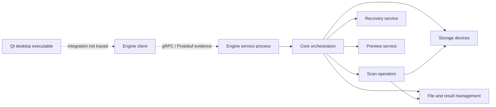

# Recoverit: bounded static architecture review

Date: **25 October 2026**. Scope: eight binaries from a user-supplied Windows installation, examined at the user's explicit request. This review records high-level observations for independent engineering. It does not establish feature parity with Recoverit.

**Summary:** static inspection identified separate storage, scanning, recovery, preview and result-management modules, with gRPC/Protobuf indicators at the client/service boundary. Filesystem and fragmented-format class names are present. These identifiers do not establish the underlying algorithms or their correctness. Memory Regainer requires independent implementations grounded in public specifications and reproducible tests.

## Method and boundaries

PE/COFF headers, section tables, imports, exports, C++ symbol names and selected filesystem/recovery identifiers in ASCII and UTF-16 strings were inspected. RVA-to-file-offset mapping and bounds checks followed the [Microsoft PE format specification](https://learn.microsoft.com/en-us/windows/win32/debug/pe-format). SHA-256 was computed over each complete file. `file` independently identified the sampled executables as Windows x86-64 PE32+.

None of the supplied executables, DLLs, installers or scripts was run. No source-code decompilation, instruction-level algorithm reconstruction, process injection, activation change, DRM bypass or credential inspection was performed. User logs, cookies and account/activation data were not examined. Proprietary binaries, assets, signature databases, protocol schemas and implementation code were not added to Memory Regainer or published. The local analysis scratch files contain metadata only and are not release components.

Imports show referenced modules/functions, not the arguments, control flow or runtime use of those functions. An imported write API does not by itself prove source-disk writes: it may write recovered files or other outputs. RTTI/type names are evidence of compiled types, not proof that every named feature works, is enabled or has a particular recovery success rate. Unanchored keyword counts were used only to guide inspection, not as support claims.

## Identified files

All eight use PE32+ machine `0x8664` (AMD64). These hashes identify only the supplied copies; authenticity and vendor signatures were not validated.

| File | Bytes | SHA-256 |
| --- | ---: | --- |
| `recoverit.exe` | 42,032,344 | `612387056df6c220947df9a01b9e7bf08d96689734dd1aeaeba2715d81c4b1d0` |
| `drcore.dll` | 1,738,456 | `5902fe4cc52c7809619b2c2f9cdb28d6d4cdccbabe45143c4a8983a86b492420` |
| `datarecovery.dll` | 1,241,304 | `07f5f1cbf459dcc8c5c64cf1170a2f609f45bae28ba9e3a0ef6e80ee9d1d5377` |
| `drengsrv.exe` | 5,273,304 | `452e12c74558b67bf698a825b220c4176c5fe3101075ac790470b79f11ea568d` |
| `drengcli.dll` | 4,893,400 | `87b2f951337b50bc573b0adbe78c6abd851d5bcda6b8d945dde8a476b55e8d54` |
| `drstoragedevice.dll` | 5,192,920 | `bbf5d75c754cb0e485f2b04534c623e2117667654c47d37eed3a3d962a021756` |
| `PartitionManager.dll` | 3,761,368 | `03ca578ff582bef37a304d8a5240381d25e94a602c4d6c3750d28f559e92db45` |
| `scanopreator.dll` | 5,376,728 | `e4981d562a8d14e2f2ff309bbde5e318c0ad6442be00d42a733c5269cc542a3a` |

## Observations and interpretation

| Area | Directly observed evidence | Bounded interpretation |
| --- | --- | --- |
| Desktop interface | `recoverit.exe` imports Qt5 Widgets, Gui, Core and Concurrent modules. | A Qt desktop shell is present. Its exact hand-off to the engine client was not traced. Memory Regainer can retain its independent Tauri interface. |
| Service boundary | `drengsrv.exe` imports `drcore.dll`. `drengcli.dll` exports `InitGrpcServiceLib`; both client/server contain Protobuf identifiers. Client RTTI includes scan and recovery request/reply types. | Strong evidence of a typed client/service architecture using gRPC/Protobuf. Endpoints, network exposure, transport security and message contracts were not reconstructed. |
| Core orchestration | `drcore.dll` imports separate scan, storage, recovery, preview, file-management and data-management DLLs. Exported identifiers include engine/scan/recovery managers, task queues and buffer creation. | Recovery appears coordinated through shared abstractions and dedicated subsystems rather than one monolithic signature loop. Exact scheduling and ownership are unknown. |
| Windows storage | `drstoragedevice.dll` imports SetupAPI enumeration, COM, volume enumeration, `DeviceIoControl`, file reads and seeking. Its symbols refer to API/WMI disk discovery and lost-partition exploration. | Storage discovery and I/O are abstracted separately. Imported APIs do not prove any particular IOCTL, access mode, privilege or error-handling policy. |
| Filesystem strategies | `scanopreator.dll` exposes scan-operator factories. RTTI names identify NTFS, exFAT, FAT16/32, ext4, APFS, Btrfs, HFS+ and ReFS scan operators, including deletion/format variants. | The binary contains filesystem-specific strategies. It is not sufficient evidence to claim complete support for each filesystem, encrypted state or deletion scenario. |
| Raw and fragmented scanning | RTTI includes a raw scan operator and JPEG, MP4, MXF, PDF and ZIP fragment-related operators. NTFS log scanning types also appear. | Metadata recovery and content scanning are distinct paths, with format-specific fragmentation work. The reconstruction heuristics and correctness were not recovered from names. |
| Work selection | Core identifiers refer to filesystem/advanced-scan bitmaps, buffer windows, queues and bad-sector counters. | Likely mechanisms for choosing work ranges and coordinating I/O. Bitmap semantics, buffer sizes, retry policies and complexity remain unknown. |
| Lifecycle and saved state | Symbols refer to pause/resume/stop at engine, scan, recovery and task levels, plus save/load scan results and persistence. | The API exposes controls beyond a single start/cancel operation. Safe checkpoint semantics, crash consistency and source validation were not established. |
| Recovery service | `datarecovery.dll` contains recovery-interface types and a factory returning a recovery interface. | A distinct recovery service exists. One factory's name refers to preview, so names alone should not be used to infer its entire role. |
| Separate partition utilities | `PartitionManager.dll` exports names for disk layouts, GPT/MBR construction, partition changes and boot/migration services; it imports VSS and volume APIs. | The installation includes functionality beyond undelete. This DLL was not a direct import of the inspected core. Its modifying operations are not appropriate additions to Memory Regainer's read-only recovery flow. |

The following diagram separates observed imports (solid arrows) from inferred integration (dotted arrows):

The service/client interpretation is consistent with the general concepts in the [official gRPC architecture documentation](https://grpc.io/docs/what-is-grpc/core-concepts/). That documentation is not evidence of this product's exact wire protocol or deployment configuration.

## Independent implementation priorities for Memory Regainer

These are engineering proposals derived from common requirements and public standards. No recovered proprietary implementation is needed to implement them.

1. **Filesystem recovery before expanding marketing claims.** The subsequent v0.1.0 implementation added a narrow exFAT path using Microsoft's [exFAT specification](https://learn.microsoft.com/en-us/windows/win32/fileio/exfat-specification). Expand interoperability and malformed-image fixtures while keeping allocated-versus-free evidence, fragmentation assumptions and overwritten ranges explicit; see the [feature matrix](FEATURES.md).
2. **NTFS with real record/run validation.** Implement image-based MFT record checks, update-sequence fixups, resident/nonresident attributes, bounded runlists and deleted-record handling from independently reviewed public sources. A common shortcut is insufficient: Microsoft's [FSCTL_GET_NTFS_FILE_RECORD](https://learn.microsoft.com/en-us/windows/win32/api/winioctl/ni-winioctl-fsctl_get_ntfs_file_record) returns in-use records; that API alone is not an undelete engine. Validate results on synthetic images before claiming NTFS recovery.
3. **Stable storage interfaces and physical-device identity.** Expose geometry, bounded `read_at`, cancellation and explicit read errors behind a platform-neutral reader. Qualify native Windows mapping using documented APIs such as [IOCTL_VOLUME_GET_VOLUME_DISK_EXTENTS](https://learn.microsoft.com/en-us/windows/win32/api/winioctl/ni-winioctl-ioctl_volume_get_volume_disk_extents), which can identify one or more underlying disks. Preserve source-write prevention.
4. **Persistent result indexing and scan lifecycle.** Store result batches and checkpoints in a versioned local database on safe destination storage. Make checkpoint state include source identity, options, reader version, completed ranges and pending work. Define pause/cancel/complete states independently; resuming a checkpoint must be different from reopening a session and rescanning.
5. **Separate scanning and reconstruction.** Use a result model containing provenance, candidate extents, structural checks and confidence reasons. Recovery should validate its chosen extents, stream to new output, verify read-back hashes and report failed/unattempted entries. File preview should consume only bounded data through isolated format handlers.
6. **Format-specific fragmentation, one format at a time.** Start from public format structures and reproducible fragmented fixtures. Do not join distant fragments merely because their signatures look compatible. Structural boundary recovery, payload validation and repair are distinct capabilities and require distinct evidence.
7. **Additional filesystems after those foundations.** Use the Linux kernel's [ext4 structure documentation](https://www.kernel.org/doc/html/latest/filesystems/ext4/index.html) for inode/extent/directory work, with compatible licensing review for any reused implementation. Treat APFS snapshots/encryption, Btrfs trees and ReFS as separate research efforts. Detection is not undelete support.

A separate privileged helper may later improve fault isolation and permission boundaries, but reproducing the observed gRPC architecture is not a prerequisite for working recovery. The present app can evolve through a narrow internal command contract first. No service should expose disk access to arbitrary local or network callers.

## What this review does not prove

This was a bounded static architecture review, not a complete reverse engineering of Recoverit. It did not recover the filesystem algorithms, fragment-ranking rules, proprietary signature registry, encryption logic, performance characteristics or runtime recovery outcomes. It did not establish that copying or renaming functions would reproduce the product's behavior. A different source implementation still needs its own correctness tests, dependency review and safety validation.

Memory Regainer remains an independent project. This report is descriptive analysis; no affiliation, endorsement, proprietary-code derivation or feature-equivalence claim is made.

## Follow-up: I/O, task dispatch and power APIs

A second read-only pass examined the direct PE import tables of the same `recoverit.exe`, `drcore.dll`, `drengcli.dll`, `drengsrv.exe`, `drstoragedevice.dll` and `scanopreator.dll`, plus `drfoundation.dll`. The first six hashes match the table above. `drfoundation.dll` is identified in the [I/O research note](RECOVERY_IO_RESEARCH.md). The desktop executable directly imports `SetThreadExecutionState`; this is concrete evidence of a power-management API reference, but its flags and active lifetime were not reconstructed. Client and server modules import I/O completion-port functions and thread creation. The storage module imports disk control, synchronous reads, seeking, events and waits.

No direct `CancelIo`, `CancelIoEx` or `CancelSynchronousIo` import was present in these seven inspected import tables. This does not establish absence of cancellation: it could be implemented through other modules, dynamic resolution or cooperative state. Completion-port imports could belong to RPC networking rather than disk reads. No claim of guaranteed cancellation, sleep recovery or asynchronous raw-disk I/O follows from these observations. The independently verified public-source comparisons and resulting design recommendations are recorded in [RECOVERY_IO_RESEARCH.md](RECOVERY_IO_RESEARCH.md).
